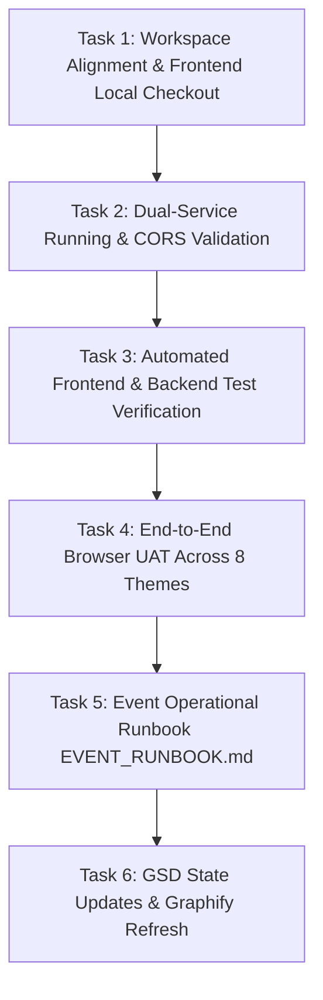

# Phase 5 Plan: Frontend Integration Docs, UAT & Event Readiness

## Metadata
- **Phase**: 5
- **Focus**: End-to-End Frontend/Backend Integration, Dual-App Local Setup, Comprehensive Browser UAT, Event Runbook, and Milestone 1 Completion
- **Location**: `frontend/`, `backend/`, `.planning/`
- **Dependencies**: Phase 1 (Scaffolding), Phase 2 (Curated Datasets), Phase 3 (Gemini & Fallback Engine), Phase 4 (REST API & WhatsApp Formatter)
- **Status**: Ready for Review / Approval

---

## 1. Objective
Achieve complete end-to-end integration and operational readiness for the "Chaos to Solution" hackathon challenge generator. Validate the live communication between Imadulla's completed frontend and Safiya's Express backend across all 8 themes, verify transparent fallback behavior when AI is offline or rate-limited, document the dual-service local running procedures, perform conversational UAT in the browser, and publish an event runbook ensuring 100% hackathon uptime.

---

## 2. Architectural & Integration Context

### Frontend Baseline (`origin/main`)
- Developed by Imadulla using React + Vite + Tailwind CSS.
- Calls `POST /api/challenges/generate` with `{ theme: string }`.
- Expects response envelope `{ success: true, data: { id, theme, generatedAt, source, challenge, shareText } }`.
- Supports 8 approved themes: `EdTech`, `FinTech`, `HealthTech`, `Sustainability`, `Smart Cities`, `Accessibility`, `E-commerce`, `Open Innovation`.
- Features interactive 3D-styled flip cards for Problem Statement (with Deliverable), Technical Restriction, and Resource (with documentation link).
- Features WhatsApp sharing with Indian phone number (+91) validation and click-to-chat URL generation (`https://wa.me/91...`).

### Backend Baseline (`refs/heads/backend`)
- Node.js + Express with ES Modules, Helmet, and CORS.
- Exposes `GET /api/health`, `GET /api/mock/:dataset`, and `POST /api/challenges/generate`.
- Powered by `@google/genai` (`gemini-3.8-flash`) with strict 10000ms timeout and transparent fallback to curated datasets.
- 48 automated unit and integration tests passing.

---

## 3. Atomic Tasks & Dependencies



### Task 1: Workspace Alignment & Frontend Local Checkout
- **Goal**: Bring the completed frontend files from `origin/main` into the working tree on `backend` branch (without destructive merges or modifying remote frontend branch).
- **Actions**:
  - Run `git checkout origin/main -- frontend` to place the complete frontend source, components, and tests into `./frontend/`.
  - Create `frontend/.env` based on `frontend/.env.example` with:
    ```env
    VITE_API_BASE_URL=http://localhost:5000
    VITE_USE_MOCK=false
    ```
  - Verify that `frontend/.env` is ignored by `.gitignore`.
  - Inspect `frontend/package.json` and install any missing dependencies via `npm install` inside `frontend/`.

### Task 2: Dual-Service Running & Configuration Validation
- **Goal**: Confirm backend and frontend run seamlessly side-by-side with zero port conflicts or CORS blocking.
- **Actions**:
  - Verify backend port (`5000`) and CORS origin (`http://localhost:5173`).
  - Verify frontend port (`5173`) and API base URL (`http://localhost:5000`).
  - Confirm `GEMINI_API_KEY` remains exclusively in `backend/.env` and is never exposed in client bundles or network requests.

### Task 3: Automated Test Verification
- **Goal**: Run and verify both automated test suites with zero failures.
- **Actions**:
  - Run backend test suite: `cd backend && npm test` (all 48 tests pass).
  - Run frontend test suite: `cd frontend && npm test` (verify all frontend component & utility tests pass).

### Task 4: End-to-End Browser UAT Across All 8 Themes
- **Goal**: Visually and functionally validate the complete user journey in the browser using live backend.
- **Actions**:
  - Start backend server on port 5000 and frontend preview/dev server on port 5173.
  - Launch browser agent to test:
    1. Initial loading of Theme Selection screen (8 theme cards).
    2. Theme selection (e.g. `EdTech`) and clicking "Generate Challenge".
    3. Loading state transition.
    4. Challenge Reveal screen:
       - Problem card flip and Deliverable render.
       - Restriction card flip and constraint rule render.
       - Resource card flip and "Open Documentation" external link.
    5. Source badge assertion (`AI Generated` or `Backup Challenge`).
    6. Testing curated fallback path by temporarily simulating Gemini offline/timeout.
    7. WhatsApp sharing form: Enter Indian 10-digit number (`9876543210`), verify green button enables and generates valid `https://wa.me/919876543210?text=...` link containing the challenge details.
    8. Back button navigation to return to theme selection.
  - Capture all results in `.planning/phases/05-integration/05-UAT.md`.

### Task 5: Event Operational Runbook (`EVENT_RUNBOOK.md`)
- **Goal**: Create a comprehensive, fail-safe guide for event coordinators and student volunteers at SJCIT.
- **Actions**:
  - Write `EVENT_RUNBOOK.md` in repository root covering:
    - Pre-event checklist (system requirements, API key check, dependency installation).
    - Single-command start procedures for both services.
    - Venue Wi-Fi drop contingency: How offline fallback datasets and local mock routes guarantee 100% uptime.
    - Gemini quota exhaustion contingency (how curated fallbacks take over automatically without downtime).
    - Common error codes and rapid troubleshooting steps.
    - Volunteer verification script before participant entry.

### Task 6: GSD State Updates & Graphify Refresh
- **Goal**: Finalize project documentation and mark Phase 5 complete.
- **Actions**:
  - Re-run Graphify extraction to document the integrated architecture.
  - Update `backend/README.md` with dual-running instructions.
  - Update `.planning/STATE.md` and `.planning/ROADMAP.md` marking Phase 5 and Milestone 1 as COMPLETED.
  - Commit all integration artifacts cleanly.

---

## 4. Acceptance Criteria
1. **End-to-End Connectivity**: Frontend successfully fetches and renders challenges generated by `POST http://localhost:5000/api/challenges/generate`.
2. **All 8 Themes Operational**: Every theme produces a valid, playable challenge triad with deliverable.
3. **Resilience Verified**: Network drops or Gemini 429 quota exhaustion transparently yield curated fallbacks with `"source": "curated-fallback"` and `Backup Challenge` badge.
4. **WhatsApp Handoff Verified**: Valid 10-digit Indian numbers generate correct `wa.me` URLs with zero server-side phone logging.
5. **Zero Secrets in Frontend**: `GEMINI_API_KEY` is not present in frontend code, environment, or browser network responses.
6. **Full Test Green**: 100% passing tests in both backend (48/48) and frontend test harnesses.
7. **Complete Runbook**: `EVENT_RUNBOOK.md` provides clear, actionable instructions for event day.

---

## 5. Files to Create or Modify

| File | Action | Purpose |
| :--- | :--- | :--- |
| `frontend/` | Checked out from `origin/main` | Access Imadulla's completed frontend source and tests |
| `frontend/.env` | Created | Set `VITE_API_BASE_URL=http://localhost:5000` and `VITE_USE_MOCK=false` |
| `.planning/phases/05-integration/PLAN.md` | Created | Phase 5 execution plan |
| `.planning/phases/05-integration/05-UAT.md` | Created | Conversational and visual UAT verification report |
| `EVENT_RUNBOOK.md` | Created | Operational runbook for IEEE CS event at SJCIT |
| `backend/README.md` | Modified | Add dual-running instructions and runbook link |
| `.planning/STATE.md` | Modified | Update phase state and decisions |
| `.planning/ROADMAP.md` | Modified | Update Phase 5 status to COMPLETED |
| `.planning/graphs/graph.json` | Modified | Refreshed Graphify knowledge graph |

---

## 6. Risks and Mitigations

| Risk | Impact | Mitigation |
| :--- | :--- | :--- |
| Spotty venue Wi-Fi at SJCIT | High | Automatic curated fallback service + offline mock datasets ensure 100% uptime with zero external network dependency. |
| Gemini free-tier rate limits (5 RPM) | High | Backend automatically catches 429 errors and falls back to curated Phase 2 challenges without user-facing error. |
| CORS origin mismatch | Medium | Backend `CORS_ORIGIN` permits `http://localhost:5173` and `http://localhost:3000` out of the box. |
| Git merge conflict with frontend branch | High | We do NOT merge or overwrite frontend branches; we cleanly check out `frontend/` files into working tree for integration testing. |
