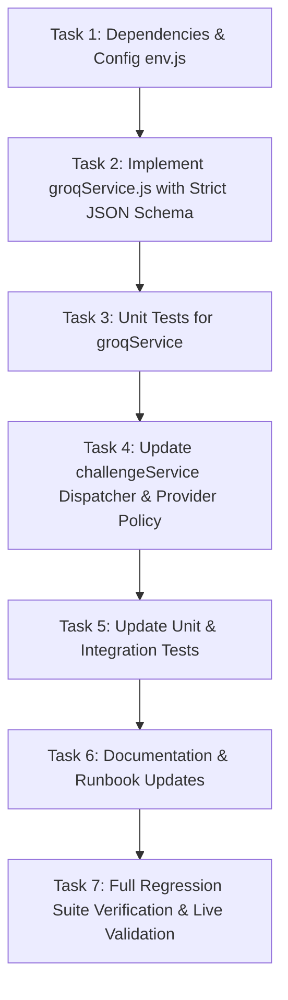

# Phase 6 Plan: Groq AI Provider Integration

## Metadata
- **Phase**: 6
- **Focus**: Groq AI Provider Integration, Configurable Multi-Provider Dispatcher, Sub-Second Resilient Fallback, and Comprehensive Regression Testing
- **Location**: `backend/`, `.planning/`
- **Dependencies**: Phase 1 (Scaffolding), Phase 2 (Curated Datasets), Phase 3 (AI Generator & Fallback Engine), Phase 4 (REST API), Phase 5 (Frontend Integration & Event Readiness)
- **Status**: Planned / Pending Review & Execution

---

## 1. Objective
Integrate **Groq** (`groq-sdk`) as the primary high-speed AI generation engine (`llama-3.3-70b-versatile`) for the Chaos to Solution (CTS) challenge generator. Retain **Google Gemini** as an optional configurable secondary provider and preserve the curated dataset reservoir ([fallbackService.js](file:///c:/Users/babajan/OneDrive/Desktop/CTS/backend/src/services/fallbackService.js)) as the zero-downtime offline fallback. Guarantee zero breaking changes to the REST contract (`POST /api/challenges/generate`) or the React frontend.

---

## 2. Architectural Context & Technical Invariants

### 2.1 Provider Architecture
Implement a minimalist, decoupled provider pattern:
- **Consistent Provider Interface**:
  ```js
  generate(theme: string, recentHistory?: string[]): Promise<ChallengeObject>
  ```
  Both [groqService.js](file:///c:/Users/babajan/OneDrive/Desktop/CTS/backend/src/services/groqService.js) and [geminiService.js](file:///c:/Users/babajan/OneDrive/Desktop/CTS/backend/src/services/geminiService.js) implement this exact signature.
- **Provider Dispatcher in [challengeService.js](file:///c:/Users/babajan/OneDrive/Desktop/CTS/backend/src/services/challengeService.js)**:
  - Active provider is determined by `config.aiProvider` (default: `'groq'`).
  - **Missing Key / Outage Policy**:
    1. If the active provider (`groq`) is configured and its API key is present, attempt generation via Groq.
    2. If active provider's API key is missing or fails, inspect whether alternative provider (`gemini`) is configured with a valid API key. If yes, fail over to Gemini.
    3. If neither provider succeeds, or if rate limits (`429`), timeouts, or schema invalidations occur, immediately engage [fallbackService.js](file:///c:/Users/babajan/OneDrive/Desktop/CTS/backend/src/services/fallbackService.js).
- **Zero Frontend Impact**:
  - The REST endpoint remains `POST /api/challenges/generate`.
  - Request: `{ "theme": "EdTech" }`.
  - Response envelope:
    ```json
    {
      "success": true,
      "data": {
        "id": "cts-edtech-xyz123",
        "theme": "EdTech",
        "generatedAt": "2026-10-28T...",
        "source": "ai",
        "challenge": {
          "theme": "EdTech",
          "problem": { "title": "...", "statement": "..." },
          "restriction": { "name": "...", "rule": "..." },
          "resource": { "name": "...", "type": "browser-api", "guidance": "...", "docsUrl": "..." },
          "deliverable": "..."
        },
        "shareText": "..."
      }
    }
    ```
  - When AI fails or rate limits occur: `source: "curated-fallback"`.

### 2.2 Groq Implementation Specifications
- **SDK**: Official `groq-sdk` Node.js client.
- **Default Model**: `llama-3.3-70b-versatile` (1,000 RPD, 30 RPM, 12,000 TPM; high-quality reasoning).
- **Secondary Model Support**: `llama-3.1-8b-instant` (14,400 RPD, 30 RPM, 6,000 TPM; sub-300ms speed).
- **Structured Output Enforcement**:
  - Use `response_format: { type: "json_schema", json_schema: { name: "challenge_generation", strict: true, schema: ... } }`.
  - In strict mode, every property must be explicitly included in `required: [...]` and every object level must define `additionalProperties: false`.
- **Validation**:
  - Pipe generated output through existing [challengeValidator.js](file:///c:/Users/babajan/OneDrive/Desktop/CTS/backend/src/utils/challengeValidator.js) (`validateChallenge`).
  - Enforces character length boundaries, theme match, valid HTTP/HTTPS docs URLs, allowed resource types (`browser-api`, `public-api`, `local-dataset`), and strict prohibition of banned paid services/hardware keywords.
- **Anti-Repeat History**:
  - Feed `recentHistory` (last 30 `${theme}:${title}` signatures) into the prompt instructions so the model actively generates novel challenge scenarios.
- **Fail-Fast Error Handling**:
  - Never retry on `429`, `rate_limit_exceeded`, `503`, or timeouts. Break immediately to `fallbackService` to keep total response time under 1 second.
  - Set request timeout to 4,000ms (`AI_TIMEOUT_MS`).

---

## 3. Atomic Tasks & Work Breakdown



### Task 1: Dependencies & Environment Configuration
- **Files**:
  - [backend/package.json](file:///c:/Users/babajan/OneDrive/Desktop/CTS/backend/package.json)
  - [backend/src/config/env.js](file:///c:/Users/babajan/OneDrive/Desktop/CTS/backend/src/config/env.js)
  - [backend/.env.example](file:///c:/Users/babajan/OneDrive/Desktop/CTS/backend/.env.example)
- **Actions**:
  - Add `groq-sdk` dependency to `backend/package.json`.
  - Update `backend/src/config/env.js` to parse:
    - `AI_PROVIDER`: `'groq'` (default) or `'gemini'`
    - `GROQ_API_KEY`: string (default empty)
    - `GROQ_MODEL`: string (default `'llama-3.3-70b-versatile'`)
    - `AI_TIMEOUT_MS` / `GEMINI_TIMEOUT_MS`: 4000ms
  - Update `backend/.env.example` with documented keys and clean defaults.
  - Verify `backend/.env` remains untracked and excluded in `.gitignore`.

### Task 2: Implement `groqService.js` with Strict JSON Schema
- **File**: `backend/src/services/groqService.js` (new)
- **Actions**:
  - Instantiate `Groq` client using `config.groqApiKey`.
  - Define strict JSON Schema matching the challenge triad:
    - `theme`: enum of 8 approved themes.
    - `problem`: object with `title` (3-100 chars), `statement` (10-500 chars).
    - `restriction`: object with `name` (3-100 chars), `rule` (10-500 chars).
    - `resource`: object with `name`, `type` (`browser-api` | `public-api` | `local-dataset`), `guidance`, `docsUrl`.
    - `deliverable`: string (10-500 chars).
    - `additionalProperties: false` on all objects; all properties marked `required`.
  - System prompt: Emphasize 3-hour hackathon feasibility, zero paid APIs, creative restrictions, and avoidance of items in `recentHistory`.
  - Implement `withTimeout` wrapper (4,000ms max).
  - Rate-limit & timeout error guard: immediately throw non-retryable error on `429`, `rate_limit_exceeded`, `503`, or timeout.

### Task 3: Unit Tests for `groqService.js`
- **File**: `backend/tests/unit/groqService.test.js` (new)
- **Actions**:
  - Test prompt construction includes theme and anti-repeat history.
  - Test successful JSON completion parsing.
  - Test error handling when Groq API returns HTTP 429 (rate limit).
  - Test timeout abort behavior (exceeding configured timeout).
  - Test malformed or invalid response handling.
  - Use Vitest mocks to guarantee deterministic, offline test execution without consuming real API quota.

### Task 4: Update `challengeService.js` Dispatcher & Provider Policy
- **File**: [backend/src/services/challengeService.js](file:///c:/Users/babajan/OneDrive/Desktop/CTS/backend/src/services/challengeService.js)
- **Actions**:
  - Update constructor to accept configurable `aiProvider` or default to dynamic provider resolution based on `config.aiProvider`.
  - Implement fallback provider cascade:
    1. Primary provider (`groqService` when `AI_PROVIDER=groq`).
    2. Secondary provider (`geminiService` if primary key missing and Gemini key present).
    3. Curated fallback ([fallbackService.js](file:///c:/Users/babajan/OneDrive/Desktop/CTS/backend/src/services/fallbackService.js)) if all AI generation fails.
  - Preserve `validateChallenge` multi-pillar validation.
  - Preserve sliding window history (30 items) and duplicate prevention.

### Task 5: Update Existing Challenge Unit & Integration Tests
- **Files**:
  - [backend/tests/unit/challengeService.test.js](file:///c:/Users/babajan/OneDrive/Desktop/CTS/backend/tests/unit/challengeService.test.js)
  - [backend/tests/integration/challenge.test.js](file:///c:/Users/babajan/OneDrive/Desktop/CTS/backend/tests/integration/challenge.test.js)
- **Actions**:
  - Test provider switching (`AI_PROVIDER=groq` vs `AI_PROVIDER=gemini`).
  - Test missing key behavior (falls back safely with `source: "curated-fallback"`).
  - Test Groq rate-limit simulated error (drops cleanly to curated fallback).
  - Ensure all mock endpoints and health tests remain unaffected.

### Task 6: Documentation & Runbook Updates
- **Files**:
  - [backend/API.md](file:///c:/Users/babajan/OneDrive/Desktop/CTS/backend/API.md)
  - [EVENT_RUNBOOK.md](file:///c:/Users/babajan/OneDrive/Desktop/CTS/EVENT_RUNBOOK.md)
  - [backend/README.md](file:///c:/Users/babajan/OneDrive/Desktop/CTS/backend/README.md)
- **Actions**:
  - Update `API.md` architecture section documenting Groq as default provider and Gemini as secondary.
  - Update `EVENT_RUNBOOK.md` with instructions on toggling `AI_PROVIDER` and monitoring Groq rate limits.
  - Document API key acquisition and setup.

### Task 7: Full Regression Suite Verification & Live Validation
- **Actions**:
  - Run complete backend test suite (`cd backend && npm test`): 48+ tests passing.
  - Run complete frontend test suite (`cd frontend && npm test`): 30 tests passing.
  - Verify live generation when user provides the Groq API key:
    - Test `POST /api/challenges/generate` for all 8 themes.
    - Confirm response contains `source: "ai"` when Groq succeeds.
    - Verify sub-second failover when key is unset or rate-limited.

---

## 4. Key Technical Decisions & Constraints

| Decision | Selection | Rationale |
| :--- | :--- | :--- |
| **Provider Selection** | Dual-Provider Adapter (`AI_PROVIDER=groq\|gemini`) | Avoids rewriting existing Gemini logic while immediately resolving quota exhaustion. |
| **Default Groq Model** | `llama-3.3-70b-versatile` | Superior reasoning for complex hackathon restrictions and problem nuances; strict JSON schema support. |
| **Alternative Groq Model**| `llama-3.1-8b-instant` | Available via `GROQ_MODEL=llama-3.1-8b-instant` for ultra-high throughput (14,400 RPD) if 70B daily limit is approached. |
| **Schema Strictness** | `strict: true` | Token-level constrained decoding on Groq prevents invalid JSON or missing fields. |
| **Timeout Ceiling** | 4,000ms | Guarantees backend always responds well within frontend's 15,000ms timeout guard. |
| **Zero Client Secret Exposure** | Server-side only | `GROQ_API_KEY` resides strictly in `backend/.env`. Never present in Vite client bundles. |

---

## 5. Verification Commands & Acceptance Criteria

### Automated Verification
```powershell
# 1. Backend tests (unit, integration, mock, provider switching)
cd backend; npm test

# 2. Frontend regression tests
cd ../frontend; npm test

# 3. Health check
curl -s http://localhost:5000/api/health
```

### Acceptance Criteria
- [ ] `groq-sdk` installed and configured in backend.
- [ ] `groqService.js` generates challenges adhering to exact JSON schema.
- [ ] `challengeService.js` dynamically routes requests based on `AI_PROVIDER`.
- [ ] Rate limits (429) or timeouts fail over to `curated-fallback` in < 1,000ms.
- [ ] All 8 themes supported without regression.
- [ ] All existing automated tests (48 backend + 30 frontend) plus new Groq tests pass.
- [ ] No secrets logged, exposed to client, or committed to Git.
