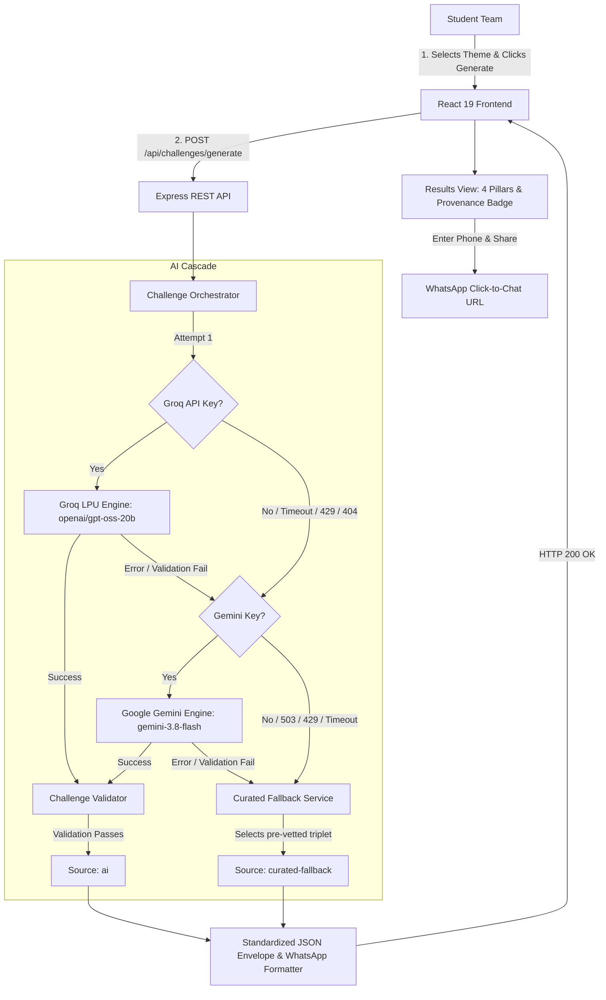

# Chaos to Solution: Challenge Generator (CTS)

[](https://www.ieee.org/)
[](https://sjcit.ac.in/)
[]()
[]()
[-brightgreen.svg)]()

> **Turn Chaos into Solution:** An AI-powered hackathon challenge generation platform built for the **IEEE Computer Society Student Branch** at **SJC Institute of Technology (SJCIT)**.

---

## 1. Project Overview

**Chaos to Solution (CTS)** generates cohesive, scoped hackathon challenges tailored to participant-selected innovation themes. Rather than open-ended brainstorming prompts, CTS generates an integrated 4-pillar challenge triad engineered specifically for a **~3 to 4-hour rapid prototype sprint**:

1. **01 — Problem Statement**: A concrete, relatable real-world friction point with an identified user persona.
2. **02 — Technical Restriction**: An architectural or UX constraint (e.g. *Zero Client-Side Frameworks*, *Single-Screen View*, *Zero Text-Input Fields*) that forces creative problem solving.
3. **03 — Prescribed Resource**: A free browser API (e.g. *Web Speech*, *Canvas*, *Web Storage*), a keyless public REST API (e.g. *Open Library*, *REST Countries*, *Open-Meteo*), or a bundled local dataset with verified documentation.
4. **04 — Expected Deliverable**: A concrete, achievable working prototype scope that teams can demonstrate to judges within the build window.

Once generated, teams can review their mission, validate their mobile number (+91), and generate a pre-formatted WhatsApp mission summary to coordinate within their team or submit to event mentors.

---

## 2. Event Details

* **Event Name**: Chaos to Solution: Challenge Generator
* **Organizer**: IEEE Computer Society Student Branch
* **Institution**: SJC Institute of Technology (SJCIT), Chickballapur
* **Format**: Theme-based student hackathon challenge generator
* **Sprint Window**: ~3 to 4-hour prototype build sprint
* **Team Structure**: Two student developers per team
* **Operational Runbook**: See [`EVENT_RUNBOOK.md`](./EVENT_RUNBOOK.md) for pre-event checklist and kiosk procedures.

---

## 3. Features

* **8 Curated Innovation Themes**:
  * `EdTech` — Educational tools, spaced repetition, accessible readers.
  * `FinTech` — Micro-expenses, split calculators, savings visualizers.
  * `HealthTech` — Medication schedules, hydration alarms, mental focus timers.
  * `Sustainability` — Campus food waste trackers, carbon calculators, reuse logs.
  * `Smart Cities` — Citizen incident reporting, transit delays, civic alerts.
  * `Accessibility` — Dyslexia-friendly readers, high-contrast tools, screen-reader focus.
  * `E-commerce` — Local artisan catalogs, pantry reorder checklists, flash-deal tickers.
  * `Open Innovation` — Creative civic tech, campus utility hacks, multi-domain mashups.
* **Resilient Multi-Provider AI Engine**:
  * **Groq LPU Primary**: High-speed challenge generation using `openai/gpt-oss-20b` (or custom Groq models) with strict JSON Schema outputs (verified live).
  * **Google Gemini Alternate**: Secondary configured failover using `gemini-3.8-flash` via `@google/genai` (verified in automated failover test suites).
  * **Curated Fallback Reservoir**: Offline fallback bank providing pre-evaluated challenges if external providers encounter network drops, model issues, or quota exhaustion.
* **Transparent Source Stamping**: Challenges explicitly indicate provenance with color-coded badges:
  * `[AI Generated]` (emerald green badge) — Synthesized by live AI provider.
  * `[Backup Challenge]` (amber badge) — Served from pre-vetted curated datasets.
* **WhatsApp Sharing**:
  * Client-side Indian mobile number validation (+91 normalization, 10-digit check).
  * Direct click-to-chat `https://wa.me/` link generation with preformatted Markdown copy.
  * Privacy-first: Phone numbers are processed purely client-side and never stored or logged by the backend.
* **Dual Operation Modes**:
  * **Live API Mode** (`VITE_USE_MOCK=false`): Communicates with the Express REST API.
  * **Offline Mock Mode** (`VITE_USE_MOCK=true` or runtime `window.__toggleMockMode()`): Runs in-browser using curated fixtures for offline operation.

---

## 4. Technology Stack

### Frontend
* **Core Framework**: React 19 (`react`, `react-dom`)
* **Build Tool & Dev Server**: Vite 8 (`vite`)
* **Styling**: Tailwind CSS v3 (`tailwindcss`, `postcss`, `autoprefixer`)
* **Icons**: Lucide React (`lucide-react`)
* **Testing**: Vitest (`vitest`), React Testing Library (`@testing-library/react`), JSDOM (`jsdom`)
* **Linter**: Oxlint (`oxlint`)

### Backend
* **Runtime**: Node.js (`v24.x LTS` or `v20.x`) with JavaScript ES Modules (`"type": "module"`)
* **Framework**: Express.js 4 (`express`)
* **AI Providers**:
  * Groq Cloud SDK (`groq-sdk`) — primary provider with structured outputs (`openai/gpt-oss-20b`)
  * Google Gen AI SDK (`@google/genai`) — alternate secondary provider (`gemini-3.8-flash`)
* **Security & Networking**: Helmet (`helmet`), CORS (`cors`), Dotenv (`dotenv`)
* **Testing**: Vitest (`vitest`), Supertest (`supertest`)

---

## 5. Architecture & Request Cascade



---

## 6. Repository Structure

```
Chaos_To_Solution/
├── README.md                 # Master repository documentation (this file)
├── EVENT_RUNBOOK.md          # Pre-event checklist, operational runbook, and contingencies
├── backend/
│   ├── src/
│   │   ├── app.js            # Express application, security middleware & route mounting
│   │   ├── server.js         # HTTP server entrypoint (default port 5000)
│   │   ├── config/
│   │   │   └── env.js        # Environment validator & configuration freeze
│   │   ├── data/
│   │   │   ├── problems.json # 20 curated hackathon problems across 5 categories
│   │   │   ├── restrictions.json # 15 technical & UX constraints
│   │   │   ├── resources.json # 15 keyless APIs, browser features & datasets
│   │   │   ├── mock/         # Offline mock response JSONs (weather, products, books...)
│   │   │   └── local/        # Bundled offline datasets (campus map, taxonomy...)
│   │   ├── middlewares/
│   │   │   ├── errorHandler.js # Standardized error response formatter
│   │   │   └── notFoundHandler.js # Standardized 404 handler
│   │   ├── routes/
│   │   │   ├── challenge.routes.js # POST /api/challenges/generate
│   │   │   ├── health.routes.js    # GET /api/health
│   │   │   └── mock.routes.js      # GET /api/mock/:dataset
│   │   ├── services/
│   │   │   ├── challengeService.js # Multi-provider orchestrator with anti-repeat cache
│   │   │   ├── groqService.js      # Groq SDK integration with JSON Schema outputs
│   │   │   ├── geminiService.js    # Google GenAI integration with fallback handling
│   │   │   ├── fallbackService.js  # Curated Phase 2 dataset selector
│   │   │   └── shareTextFormatter.js # WhatsApp Markdown copy generator
│   │   └── utils/
│   │       ├── challengeValidator.js # 8-theme bounds, URL syntax & banned-term checks
│   │       └── dataValidator.js      # Dataset schema validation & combinatorial check
│   ├── tests/
│   │   ├── integration/      # Supertest API endpoint tests (challenge, health, mock)
│   │   └── unit/             # Orchestrator, Groq service & validator unit tests
│   ├── .env.example          # Backend environment template
│   ├── API.md                # Full REST API specification
│   ├── package.json          # Backend dependencies & scripts
│   ├── vitest.config.js      # Vitest test configuration (with isolated test.env)
│   └── README.md             # Backend-specific architecture guide
└── frontend/
    ├── src/
    │   ├── components/       # ThemeSelector, ChallengeCard, WhatsAppShareForm, Header...
    │   ├── data/             # mockChallenges.js (8 themes curated fixtures)
    │   ├── services/         # challengeApi.js & mockChallengeApi.js
    │   ├── utils/            # validateChallenge.js & whatsapp.js
    │   ├── test/             # Vitest & RTL component and utility test suites
    │   ├── App.jsx           # Root UI coordinator (Screen 1 & Screen 2)
    │   ├── main.jsx          # React DOM entrypoint
    │   └── index.css         # Tailwind tokens, dark design theme & focus rings
    ├── public/
    │   └── favicon.svg       # CTS brand favicon
    ├── .env.example          # Frontend environment template
    ├── package.json          # Frontend dependencies & scripts
    ├── tailwind.config.js    # CTS color palette & tokens
    ├── vite.config.js        # Vite & Vitest configuration
    └── README.md             # Frontend-specific guide
```

---

## 7. Prerequisites

Before running CTS locally, ensure your system has:

* **Node.js**: `v20.x` or `v24.x LTS` (verified on `v24.22.1`)
* **npm**: `v10.x` or `v11.x` (verified on `11.19.1`)
* **Git**: `v2.x` or later
* **Modern Web Browser**: Google Chrome, Mozilla Firefox, or Microsoft Edge

---

## 8. Environment Configuration

The repository uses separate `.env` files for backend and frontend. Templates are committed as `.env.example`.

### Step 1: Configure Backend Environment
From the root directory:
```bash
cp backend/.env.example backend/.env
```

| Variable | Default Value | Description |
| :--- | :--- | :--- |
| `PORT` | `5000` | Port for the Express REST API server |
| `NODE_ENV` | `development` | Runtime environment (`development` or `production`) |
| `CORS_ORIGIN` | `http://localhost:5173,http://localhost:3000` | Comma-separated allowed frontend origins (add e.g. `http://localhost:5176` if needed) |
| `AI_PROVIDER` | `groq` | Primary AI provider (`groq` default, or `gemini`) |
| `AI_TIMEOUT_MS` | `4000` | Maximum timeout before initiating failover |
| `GROQ_API_KEY` | *(your key)* | Server-side Groq API key (optional for offline testing; required for live AI) |
| `GROQ_MODEL` | `openai/gpt-oss-20b` | Model ID configured on Groq (supports structured outputs) |
| `GEMINI_API_KEY` | *(optional)* | Google Gemini API key for secondary failover |
| `GEMINI_MODEL` | `gemini-3.8-flash` | Gemini model ID |
| `GEMINI_TIMEOUT_MS` | `4000` | Gemini request timeout before curated fallback |

> **Security Rule**: `GROQ_API_KEY` and `GEMINI_API_KEY` are read **exclusively server-side**. Never commit `.env` files, paste keys in git commits, or expose them in frontend bundles.

### Step 2: Configure Frontend Environment
From the root directory:
```bash
cp frontend/.env.example frontend/.env
```

| Variable | Default Value | Description |
| :--- | :--- | :--- |
| `VITE_API_BASE_URL` | `http://localhost:5000` | Base URL pointing to the Express backend |
| `VITE_USE_MOCK` | `true` (in `.env.example`) | Set `false` to connect to live backend API; `true` for offline in-browser fixtures |

---

## 9. Installation & Local Development

Run the backend and frontend simultaneously in **two separate terminal windows**:

### Terminal 1: Start Backend API
```bash
cd backend
npm install
npm run dev
```
* The server starts on **`http://localhost:5000`** with Node 24 native file watching.
* Verify operational status:
  ```bash
  curl http://localhost:5000/api/health
  # Response: {"success":true,"data":{"status":"ok","uptime":...,"version":"1.0.0"}}
  ```

### Terminal 2: Start Frontend UI
```bash
cd frontend
npm install
npm run dev
```
* The Vite dev server will start at **`http://localhost:5173`** (or next free port, such as `5176`).
* Open the displayed URL in your browser to interact with the challenge generator.

---

## 10. API Reference

Complete API documentation with response examples is available in [`backend/API.md`](./backend/API.md).

### 1. Generate Challenge
* **Endpoint**: `POST /api/challenges/generate`
* **Headers**: `Content-Type: application/json`, `Accept: application/json`
* **Example `curl` Request**:
  ```bash
  curl -X POST http://localhost:5000/api/challenges/generate \
    -H "Content-Type: application/json" \
    -d '{"theme": "EdTech"}'
  ```
* **Request Body**:
  ```json
  {
    "theme": "EdTech"
  }
  ```
  *(Supported themes: `EdTech`, `FinTech`, `HealthTech`, `Sustainability`, `Smart Cities`, `Accessibility`, `E-commerce`, `Open Innovation`)*

* **Sample Success Response (`200 OK`)** *(illustrative sample)*:
  ```json
  {
    "success": true,
    "data": {
      "id": "cts-edtech-sample123",
      "theme": "EdTech",
      "generatedAt": "2026-10-28T12:00:00.000Z",
      "source": "ai",
      "challenge": {
        "theme": "EdTech",
        "problem": {
          "title": "Book Summary Quiz Generator",
          "statement": "Build a single-page app that fetches a book summary from Open Library, displays it, then auto-generates 3 multiple-choice questions..."
        },
        "restriction": {
          "name": "No Backend",
          "rule": "All data must come from free public APIs or local storage; no authentication, databases, or payment gateways."
        },
        "resource": {
          "name": "Open Library Search API",
          "type": "public-api",
          "guidance": "Use https://openlibrary.org/search.json?q=<keyword> to fetch title and description...",
          "docsUrl": "https://openlibrary.org/developers/api"
        },
        "deliverable": "Prototype of a single-page UI that searches books, shows a summary, auto-creates 3 quiz questions, and records answers locally."
      },
      "shareText": "⚡ *CHAOS TO SOLUTION — AI Challenge* ⚡\n_IEEE Computer Society | SJC Institute of Technology_\n\n🏷️ *Theme:* EdTech\n🆔 *Challenge ID:* #cts-edtech-sample123 [AI Generated]\n..."
    }
  }
  ```

* **Sample Error Response (`400 Bad Request`)**:
  ```json
  {
    "success": false,
    "error": {
      "code": "INVALID_THEME",
      "message": "Invalid theme 'Gaming'. Must be one of: EdTech, FinTech, HealthTech, Sustainability, Smart Cities, Accessibility, E-commerce, Open Innovation"
    }
  }
  ```

### 2. Health Check
* **Endpoint**: `GET /api/health`
* **Response (`200 OK`)**:
  ```json
  {
    "success": true,
    "data": {
      "status": "ok",
      "uptime": 42,
      "timestamp": "2026-10-28T16:04:25.442Z",
      "version": "1.0.0"
    }
  }
  ```

---

## 11. AI Provider & Fallback Engine

CTS implements a resilient multi-tier fallback architecture designed for high availability during hackathons:

| Tier | Provider | Model | Latency | Activation Condition |
| :--- | :--- | :--- | :--- | :--- |
| **Tier 1 (Primary)** | **Groq Cloud** | `openai/gpt-oss-20b` | **~1.5s** | Primary generation when `GROQ_API_KEY` is present. Enforces strict JSON Schema validation (verified live). |
| **Tier 2 (Alternate)** | **Google Gemini** | `gemini-3.8-flash` | **~2.5s** (4s timeout) | Configured secondary failover when Groq encounters rate limits (429), timeouts (>4s), 404/503 errors, or schema validation failure. *(Configured failover verified in automated test suites; live Groq active)*. |
| **Tier 3 (Fallback)** | **Curated Datasets** | Local JSON Banks | **<10ms** | Transparent fallback when external API keys are absent, network is unavailable, or AI outputs fail validator bounds. |

* **Anti-Repeat Ring Buffer**: Maintains the last 30 challenge signatures in-memory to prevent immediate repetition of the same problem during the hackathon.
* **Validation Guardrails**: [`challengeValidator.js`](./backend/src/utils/challengeValidator.js) inspects all AI outputs before accepting them. Rejects banned terms (`openai`, `stripe`, `aws`, `firebase`, paid services, hardware sensors) and character length overflows.

---

## 12. Automated Testing

All automated unit and integration tests run **100% offline** without requiring live AI API keys or network calls:

```bash
# 1. Run Backend Tests (65 tests across 6 suites)
cd backend
npm test

# 2. Run Frontend Tests (30 tests across 5 suites)
cd ../frontend
npm test
```

### Verified Test Summary:
* **Backend (`65/65 passed`)**:
  * `tests/integration/challenge.test.js` (16 tests) — theme validation, envelopes, WhatsApp format, secret security
  * `tests/integration/health.test.js` (4 tests) — health probe and CORS headers
  * `tests/integration/mock.test.js` (6 tests) — offline mock dataset endpoints
  * `tests/unit/challengeService.test.js` (21 tests) — multi-provider dispatch, Groq failover, anti-repeat buffer
  * `tests/unit/groqService.test.js` (11 tests) — schema compliance, 404/503 fail-fast, timeout guard
  * `tests/unit/dataValidation.test.js` (7 tests) — curated data banks and combinatorial completeness
* **Frontend (`30/30 passed`)**:
  * `src/test/whatsapp.test.js` (12 tests) — Indian number normalization, URL encoding
  * `src/test/validateChallenge.test.js` (9 tests) — frontend contract validation
  * `src/test/ThemeSelector.test.jsx` (4 tests) — 8 theme cards rendering and selection
  * `src/test/App.test.jsx` (3 tests) — Screen 1 to Screen 2 state flow and flip cards
  * `src/test/mockChallenges.test.js` (2 tests) — curated mock fixtures completeness

---

## 13. Troubleshooting

| Symptom | Root Cause | Solution |
| :--- | :--- | :--- |
| **`CORS error` in browser console** | Frontend running on a port not listed in backend CORS origin | Add frontend URL (e.g. `http://localhost:5176`) to `CORS_ORIGIN` in `backend/.env` and restart backend. |
| **`EADDRINUSE: address already in use :::5000`** | Port 5000 occupied by previous background process | Run `lsof -i :5000` to identify PID, then terminate gracefully with `kill <PID>` (or `npx kill-port 5000`). |
| **`404 model_not_found` in backend logs** | Configured Groq model is not enabled on account | Ensure `GROQ_MODEL=openai/gpt-oss-20b` in `backend/.env`. |
| **Amber `[Backup Challenge]` badge shown instead of Green `[AI Generated]`** | Missing `GROQ_API_KEY`, quota limit (429), or model outage | Check `backend/.env` for a valid key. The app gracefully continues serving curated challenges. |
| **Frontend shows "Network Error"** | Backend API server is stopped or port mismatch | Verify backend is running in Terminal 1 (`npm run dev`) and `curl http://localhost:5000/api/health` succeeds. |
| **Frontend running offline mock data** | `VITE_USE_MOCK=true` in `frontend/.env` | Change to `VITE_USE_MOCK=false` in `frontend/.env` and restart Vite dev server. |

---

## 14. Event Operations & Runbook

For venue setup, AV projection checklist, emergency Wi-Fi procedures, and student kiosk management, consult the **[Event Operational Runbook (`EVENT_RUNBOOK.md`)](./EVENT_RUNBOOK.md)**:
* **T-30 Minutes**: Verification checklist for master kiosk laptops.
* **Emergency Offline Mode**: Run `window.__toggleMockMode()` in browser console to run 100% client-side if local LAN breaks.
* **WhatsApp Privacy**: Assurances for participant data handling.

---

## 15. Security & Development Workflow

* **Zero Secret Commitment**: API keys belong strictly in uncommitted `backend/.env` files. Both root and frontend [`.gitignore`](./.gitignore) ignore all `.env*` files.
* **Deterministic Tests**: Automated test suites use mocked service providers and do not consume provider token quotas.
* **Pull Request Guidelines**: Run both `npm test` suites (`backend` and `frontend`) before proposing code changes to maintain the 95 passing test baseline.

---

## 👥 Contributors & Acknowledgments

* **Safiya**: Backend Architecture, Groq/Gemini Multi-Provider AI Engine, Validation & Curated Fallbacks
* **Imadulla**: Frontend Engineering, Theme Selection UI, Challenge Flip Cards & WhatsApp Integration
* **Institution**: **SJC Institute of Technology (SJCIT)**, Chickballapur
* **Community**: **IEEE Computer Society Student Branch**
