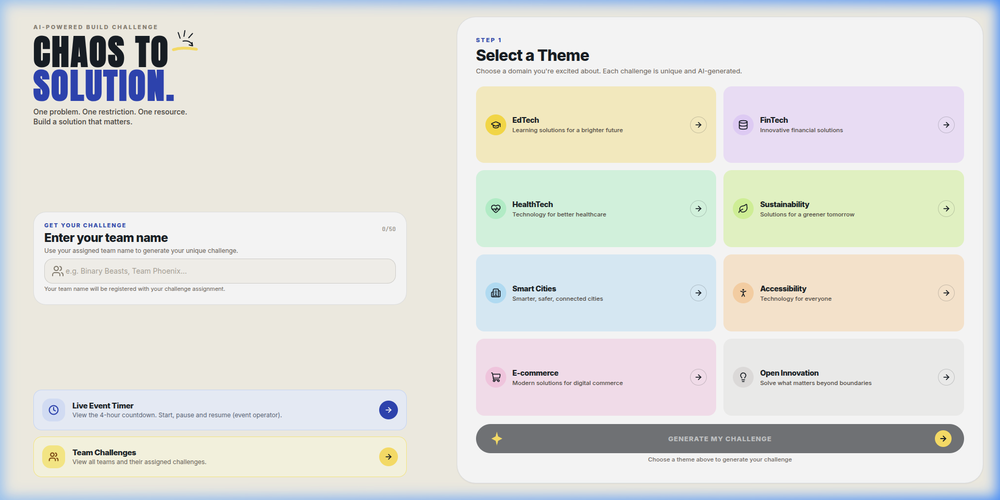
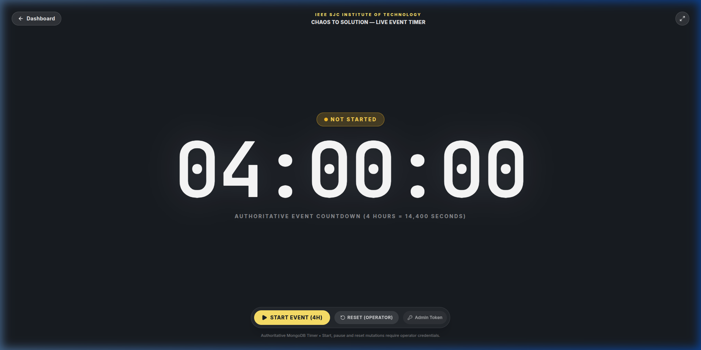
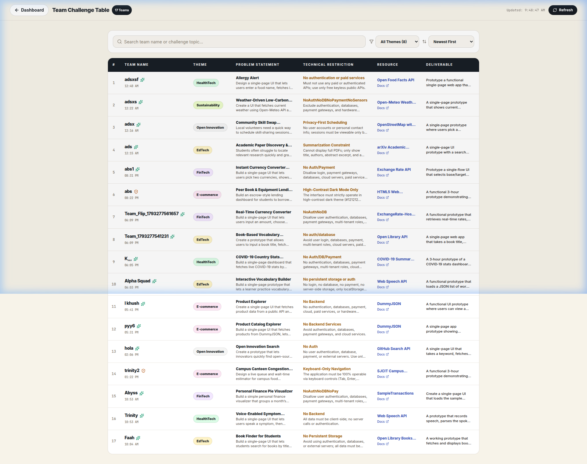
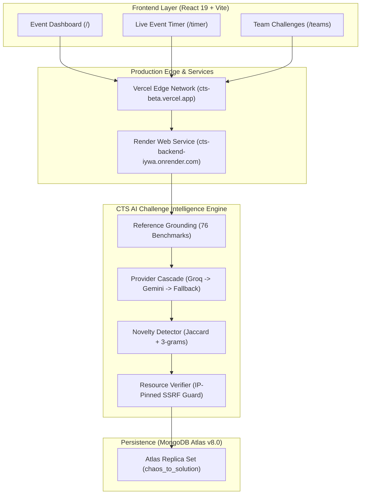
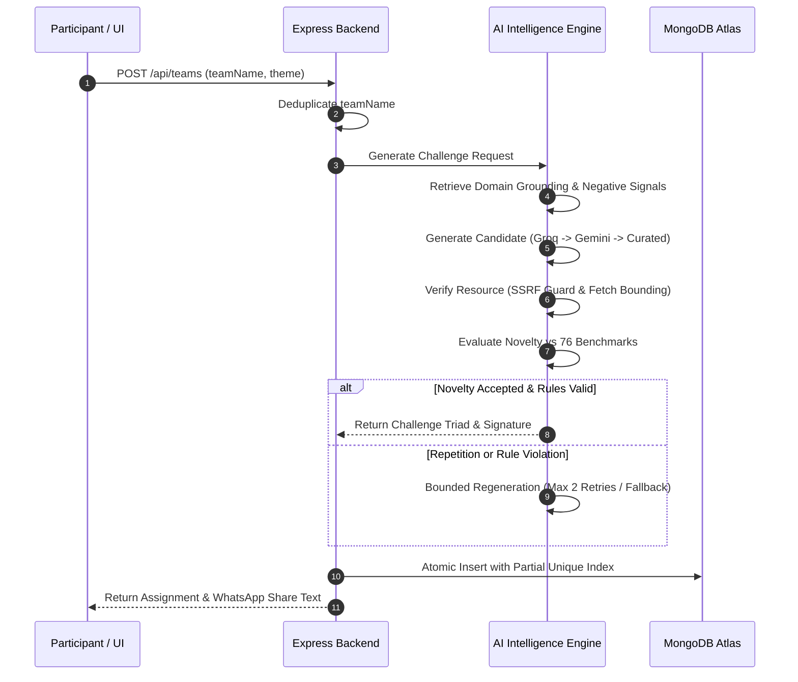

# Chaos to Solution (CTS)

> **AI-Powered Challenge Generation and Live Event Management Platform for Hackathons and Innovation Sprints.**

[](https://cts-beta.vercel.app/)
[](https://cts-backend-iywa.onrender.com/api/health)
[](https://nodejs.org/)
[](https://www.mongodb.com/atlas)
[](https://groq.com/)
[](https://github.com/safiya-18/Chaos_To_Solution/actions)

---

## 📖 Introduction

**Chaos to Solution (CTS)** is an AI-powered challenge generation platform designed for innovation challenges, hackathons, and rapid-prototyping sprints. Instead of generic or unconstrained problem statements, CTS generates an integrated **challenge triad** tailored to participant-selected innovation themes:

1. **Problem Statement**: A relatable, concrete friction point grounded in realistic personas.
2. **Technical Restriction**: An architectural constraint (e.g., *Zero External CSS Frameworks*, *Single-Screen View*, *Zero Text-Input Fields*) forcing deliberate problem solving.
3. **Prescribed Resource**: A verified browser API (e.g., *Web Speech*, *Canvas*, *Web Storage*), an open REST API, or a bundled offline dataset.
4. **Expected Deliverable**: A concrete, achievable working prototype scope that teams can demonstrate to judges within the build sprint.

CTS pairs challenge intelligence with a full event-management suite, including participant registration, team deduplication, a synchronized 4-hour countdown clock for auditoriums, and pre-formatted WhatsApp mission summaries.

---

## 📸 Application Preview

| Event Dashboard (`/`) | Live Event Timer (`/timer`) |
| :---: | :---: |
|  |  |
| *Team name registration, 8-theme selection, and challenge cards.* | *Authoritative 4-hour countdown clock for auditoriums.* |

| Team Challenges Table (`/teams`) |
| :---: |
|  |
| *Persisted team assignments, live search, theme filtering, and detail modals.* |

---

## ⚡ Key Features

| Feature | Description | Reference |
| :--- | :--- | :--- |
| **Multi-Tier AI Cascade** | High-speed primary generation via Groq LPU (`openai/gpt-oss-20b`), secondary cloud fallback via Google Gemini (`gemini-3.8-flash`), and offline curated benchmarks. | [AI Pipeline](./docs/AI_PIPELINE.md) |
| **Reference Grounding** | Grounded against a reference catalog of 76 verified benchmark challenges across 8 curated innovation domains. | [Catalog Data](file:///backend/src/data/referenceChallenges.json) |
| **Novelty Detection** | Evaluates candidate challenges using word-token Jaccard and character 3-gram metrics against benchmarks and event history to reduce repetition. | [`noveltyService.js`](./backend/src/services/noveltyService.js) |
| **SSRF-Resistant Verification** | Validates external documentation URLs with private IP blocklists (RFC 1918, link-local, cloud metadata) and IP-pinned socket connections. | [Security Guide](./docs/SECURITY.md) |
| **Atomic Uniqueness** | Enforced via a MongoDB Atlas partial unique compound index on `(eventId, challengeSignature)`, preventing duplicate assignments within the event. | [Database Guide](./docs/DATABASE.md) |
| **Authoritative Shared Timer** | Server-synchronized 4-hour hackathon countdown clock readable from across seminar halls, protected by constant-time operator authentication. | [Timer Spec](./docs/API.md#4-authoritative-event-timer) |
| **Team Management** | Case-insensitive team name deduplication, assignment search, theme filtering, and mobile-friendly WhatsApp mission export. | [API Guide](./docs/API.md) |

---

## 🌐 Supported Challenge Domains

CTS tailors challenges across 8 distinct innovation domains:

- **EdTech**: Interactive learning tools, spaced repetition, accessible readers.
- **FinTech**: Micro-expense splitters, cash-flow trackers, savings visualizers.
- **HealthTech**: Medication adherence, dietary risk detectors, mental focus timers.
- **Sustainability**: Campus food waste audits, carbon footprints, energy telemetry.
- **Smart Cities**: Transit alerts, citizen incident logging, civic utilities.
- **Accessibility**: High-contrast interfaces, screen-reader focus, dyslexia-friendly readers.
- **E-commerce**: Local artisan storefronts, pantry reorder checklists, flash-deal tickers.
- **Open Innovation**: Campus utility hacks, multi-domain mashups, civic technology.

---

## 🏗️ System Architecture



For complete technical specifications, see the [Architecture Documentation](./docs/ARCHITECTURE.md).

---

## 🔄 How CTS Works: AI Generation Workflow



> [!NOTE]
> The novelty system compares candidates against existing reference benchmarks and recent event history to minimize challenge repetition. It significantly reduces similarity while keeping generation times bounded.

---

## 💻 Technology Stack

- **Frontend**: React 19, Vite 8, TailwindCSS 3, Lucide Icons.
- **Backend**: Node.js (ES Modules, v20+), Express 4, Helmet, CORS.
- **Database**: MongoDB Atlas (v8.0+), Mongoose 9.x.
- **AI Providers**: Groq SDK (`openai/gpt-oss-20b`), Google GenAI SDK (`gemini-3.8-flash`), Curated In-Memory Datasets.
- **Testing**: Vitest, React Testing Library, Supertest, JSDOM.
- **Deployments**: Vercel (Frontend), Render (Backend), MongoDB Atlas (Database).

---

## 📂 Repository Structure

```
Chaos_To_Solution/
├── .github/                      # GitHub community templates and workflows
│   ├── ISSUE_TEMPLATE/           # Bug report and feature request templates
│   ├── PULL_REQUEST_TEMPLATE.md  # Standard pull request checklist
│   └── workflows/ci.yml          # GitHub Actions CI workflow
├── backend/                      # Node.js + Express backend service
│   ├── src/
│   │   ├── config/               # Database and environment configurations
│   │   ├── data/                 # 76 master reference challenges & mock data
│   │   ├── middlewares/          # Auth, error handling, not-found handlers
│   │   ├── models/               # Mongoose schemas (TeamAssignment, EventTimer, etc.)
│   │   ├── routes/               # Express REST route controllers
│   │   ├── services/             # AI cascade, grounding, novelty, and verifier
│   │   └── utils/                # SSRF validator, safe fetcher, challenge validator
│   └── tests/                    # Unit and integration test suites (Vitest)
├── docs/                         # Detailed system and operational guides
│   ├── ARCHITECTURE.md           # System and module architecture
│   ├── SETUP.md                  # Comprehensive local development setup
│   ├── API.md                    # Exhaustive REST API specification
│   ├── AI_PIPELINE.md            # AI cascade, grounding, and novelty mechanics
│   ├── DATABASE.md               # MongoDB schema and partial unique index
│   ├── SECURITY.md               # SSRF mitigations, IP pinning, and timing safe auth
│   ├── DEPLOYMENT.md             # Render, Vercel, and Atlas runbooks
│   ├── TESTING.md                # Test organization and execution strategy
│   └── screenshots/              # Genuine production application screenshots
├── frontend/                     # React 19 + Vite frontend application
│   ├── public/                   # Static assets, favicon, brand icons
│   └── src/
│       ├── components/           # UI components (Timer, FlipCards, Selector, etc.)
│       ├── router/               # Application navigation and view controllers
│       ├── services/             # Backend API client adapters
│       └── test/                 # Component and navigation test suites
├── .editorconfig                 # Cross-editor formatting standards
├── .gitignore                    # Production credential and artifact exclusion rules
├── render.yaml                   # Infrastructure-as-code for Render web service
├── CONTRIBUTING.md               # Contributor workflow and standards
├── CODE_OF_CONDUCT.md            # Contributor Covenant v2.1
├── SECURITY.md                   # Vulnerability reporting and disclosure policy
└── README.md                     # Project overview and entry point
```

---

## 🚀 Installation & Local Development

### Prerequisites
- Node.js `v20.x`, `v22.x`, or `v24.x`
- npm `v10.x` or higher
- MongoDB instance (local or Atlas)

### Quick Start
```bash
# 1. Clone the repository
git clone https://github.com/safiya-18/Chaos_To_Solution.git
cd Chaos_To_Solution

# 2. Setup and run the backend
cd backend
npm install
npm run dev

# 3. In a separate terminal, setup and run the frontend
cd ../frontend
npm install
npm run dev
```

For detailed configuration parameters, see the [Setup & Installation Guide](./docs/SETUP.md).

---

## ⚙️ Environment Configuration

Sample configuration for `backend/.env`:
```env
PORT=5000
HOST=0.0.0.0
NODE_ENV=development
CORS_ORIGIN=http://localhost:5173,http://localhost:3000
MONGODB_URI=mongodb://localhost:27017/chaos_to_solution

# Event Settings
EVENT_ID=cts-2026
EVENT_ADMIN_TOKEN=your_secure_operator_token
EVENT_TIMER_DURATION_MS=14400000

# AI Provider Settings (Optional: system falls back to curated if omitted)
AI_PROVIDER=groq
GROQ_MODEL=openai/gpt-oss-20b
GROQ_API_KEY=your_groq_api_key
GEMINI_MODEL=gemini-3.8-flash
GEMINI_API_KEY=your_gemini_api_key
AI_TIMEOUT_MS=4000
```

---

## 🧪 Testing

CTS maintains automated test suites across both backend and frontend:

```bash
# Run backend unit and integration suites
cd backend
npm test

# Run frontend component tests
cd ../frontend
npm test -- --run

# Validate frontend production build
npm run build
```

Detailed test organization is covered in the [Testing Documentation](./docs/TESTING.md).

---

## 🛡️ Security & Safe Practices

- **SSRF Defenses**: External resource checks resolve hostnames before connection and validate against RFC 1918, loopback, and cloud metadata (`169.254.169.254`) ranges. Connections are IP-pinned to neutralize DNS rebinding.
- **Timing Safe Authentication**: Event operator tokens are verified with constant-time cryptographic equality (`crypto.timingSafeEqual`).
- **Zero Secrets in Code**: Credentials, tokens, and database connection strings are never committed to the repository.

To report security issues, please follow our [Responsible Disclosure Policy](./SECURITY.md).

---

## 🤝 Contributing

We welcome community contributions! Please review our [Contributing Guide](./CONTRIBUTING.md) and [Code of Conduct](./CODE_OF_CONDUCT.md) before submitting pull requests.

CTS follows a trunk-based development workflow centered around short-lived feature branches merging into `main`.

---

## 📄 License & Attribution

- **Event Context**: Created for the **IEEE Computer Society Student Branch** at **SJC Institute of Technology (SJCIT)**.
- **License**: The repository currently does not include a formal open-source license. An appropriate open-source license (such as MIT or Apache 2.0) should be selected and added by the repository owner before formal open-source distribution.
