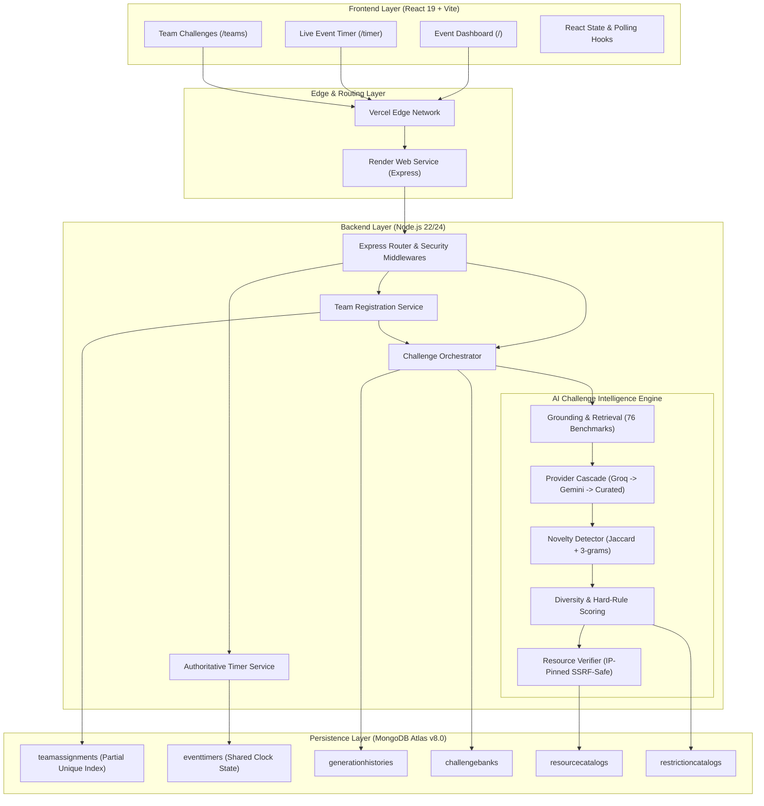

# System Architecture — Chaos to Solution (CTS)

## Overview

**Chaos to Solution (CTS)** is an AI-powered challenge generation and hackathon management platform engineered for hackathons and innovation sprints. The system delivers tailored, scoped, and architecturally constrained challenge triads across 8 innovation domains, enforcing novelty, resource feasibility, and atomic event-scoped uniqueness.

---

## High-Level System Architecture



---

## Frontend Architecture

The frontend is built using **React 19**, bundled with **Vite**, and styled with **TailwindCSS** and custom design tokens:

1. **Routing & Views (`src/router/Router.jsx`)**:
   - `Event Dashboard` (`/`): Registration interface, 8-theme selector cards, challenge card reveal interaction, and WhatsApp mission export.
   - `Live Event Timer` (`/timer`): High-contrast 4-hour countdown clock with status badges (`NOT STARTED`, `EVENT RUNNING`, `FINAL HOUR`, etc.) and operator modal controls.
   - `Team Challenges` (`/teams`): Searchable, filterable table displaying registered teams, themes, challenge pillars, and mission detail modals.
2. **State & Lifecycle Management**:
   - Polling hooks synchronizing authoritative server time every 5 seconds.
   - Ephemeral operator token modal dialogs ensuring `EVENT_ADMIN_TOKEN` is never persisted to `localStorage` or `sessionStorage`.
3. **Responsive Design System**:
   - CSS grid layouts with mobile breakpoints preventing element overlap.
   - Flip-card animation components supporting touch interaction and desktop click toggling.

---

## Backend Architecture

The backend is built as a modular **Node.js (ESM)** and **Express** service:

1. **Security & Request Pipeline (`src/app.js`)**:
   - `Helmet`: Content Security Policy and HTTP security headers.
   - Dynamic `CORS` delegate: Permits Vercel production domains, local development ports, and loopback addresses.
   - JSON body parsing with strict size bounds.
   - Centralized `errorHandler` returning standardized `{ success: false, error: { code, message } }` payloads.
2. **Core Domain Services**:
   - `teamService.js`: Orchestrates team registration, name deduplication (`normalizedTeamName`), atomic challenge generation, and persistence.
   - `timerService.js`: Computes monotonic event timer state from MongoDB timestamps (`startedAt`, `endsAt`, `pausedAt`), preventing client-side drift.
   - `challengeService.js`: Implements the 3-tier cascade (Groq primary, Gemini secondary, Curated fallback) with bounded retry loops.
3. **AI Intelligence Engine Services**:
   - `groundingService.js`: Injects domain-specific reference challenges and verified tools into model prompts.
   - `noveltyService.js`: Evaluates candidate similarity against 76 curated benchmarks and recent team history using token Jaccard and character 3-gram metrics.
   - `diversityService.js`: Scores structural variety and enforces hard rules (e.g. rejecting inaccessible resources).
   - `resourceVerifier.js` & `safeFetcher.js`: Performs DNS resolution checking, IP pinning, private range filtering (SSRF protection), and size limits.

---

## Database Architecture & Concurrency

- **Engine**: MongoDB Atlas Replica Set (MongoDB 8.0+).
- **Atomic Challenge Uniqueness**:
  - Compound partial unique index on `teamassignments`:
    ```javascript
    { eventId: 1, challengeSignature: 1 }
    // partialFilterExpression: { challengeSignature: { $type: "string" } }
    ```
  - Eliminates duplicate challenge assignments across concurrent registrations within the same event.
  - Automatically exempts legacy records with null/missing signatures.
- **Data Collections**:
  - `teamassignments`: Primary participant registration records and assigned challenge payloads.
  - `eventtimers`: Authoritative shared countdown clock state for `cts-2026`.
  - `generationhistories`: Diagnostic log capturing provider performance, novelty scores, and fallback triggers.
  - `resourcecatalogs`: Cached reachability and metadata for online tools and public APIs.
  - `challengebanks`: Master benchmark challenges ingested from reference catalogs.
  - `restrictioncatalogs`: Normalized categories of architectural constraints.
