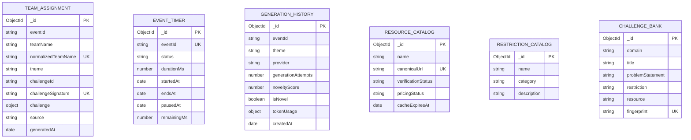

# Database Architecture & Mongoose Models — Chaos to Solution (CTS)

## Overview

CTS uses **MongoDB** managed via **Mongoose 9.x**. The database layer is designed for high concurrency, event-scoped uniqueness, and zero downtime for legacy records.

---

## Database Collections & Models



---

## 1. `TeamAssignment` (`backend/src/models/TeamAssignment.js`)

Primary collection recording participant registrations and generated challenge payloads.

| Field | Type | Required | Description |
| :--- | :--- | :--- | :--- |
| `eventId` | String | Yes | Partition identifier for the event (e.g. `cts-2026`). Default indexed. |
| `teamName` | String | Yes | User-provided display team name (2–50 characters). |
| `normalizedTeamName` | String | Yes | Lowercase, whitespace-trimmed team name for unique index constraint. |
| `theme` | String | Yes | One of the 8 approved hackathon themes. |
| `challengeId` | String | Yes | Unique human-readable challenge identifier. |
| `challengeSignature` | String | No | Deterministic SHA-256 hash of theme, problem statement, restriction, and resource. |
| `challenge` | Object | Yes | Embedded document containing `problem`, `restriction`, `resource`, and `deliverable`. |
| `source` | String | Yes | Provenance tag: `'ai'` (Groq/Gemini) or `'curated-fallback'`. |
| `generatedAt` | Date | Yes | Creation timestamp. |

### Indexes:
1. `normalizedTeamName: 1` (`unique: true`): Prevents duplicate team registrations globally.
2. `eventId: 1, challengeSignature: 1` (`unique: true`, **partial unique index**):
   ```javascript
   partialFilterExpression: {
     challengeSignature: { $type: "string" }
   }
   ```
   **Behavior**: Enforces that no two teams in the same event receive an identical challenge signature. Because of the partial filter, legacy records with missing or `null` signatures are exempt and remain intact without indexing errors.

---

## 2. `EventTimer` (`backend/src/models/EventTimer.js`)

Persists the authoritative event clock state for synchronized countdown across auditoriums and client browsers.

| Field | Type | Description |
| :--- | :--- | :--- |
| `eventId` | String | Unique event identifier (`cts-2026`). |
| `status` | String | State: `'not_started'`, `'running'`, `'paused'`, or `'ended'`. |
| `durationMs` | Number | Total duration in milliseconds (default: `14,400,000` ms = 4 hours). |
| `startedAt` | Date | Timestamp when timer was initiated. |
| `endsAt` | Date | Monotonic timestamp when the event expires. |
| `pausedAt` | Date | Timestamp of timer pause (null when running). |
| `remainingMs` | Number | Milliseconds remaining at pause. |

---

## 3. Supporting Engine Collections

- **`GenerationHistory`**: Diagnostic logs tracking LLM performance, latency, provider transitions (Groq -> Gemini -> Fallback), and composite novelty scores.
- **`ResourceCatalog`**: Persistent cache storing reachability test results, SSRF validation outcomes, and response metadata for online APIs.
- **`ChallengeBank`**: Master catalog of 76 reference benchmarks used for grounding and offline fallback.
- **`OfficialCuratedKnowledgeBase`** (`backend/src/data/officialCuratedChallenges.json`): 40 official curated challenge records across FinTech, Sustainability, EdTech, and Open Innovation extracted from organizer challenge PDFs.
- **`RestrictionCatalog`**: Architectural constraints categorized into UX, client framework, algorithmic, and data persistence limitations.

---

## 4. Safe Index Migration & Compatibility

When deploying index changes:
- Always use `partialFilterExpression` when indexing nullable or optional fields.
- Use explicit non-blocking queries before applying uniqueness constraints.
- In Mongoose 9.x, use `returnDocument: 'after'` instead of deprecated `{ new: true }` for `findOneAndUpdate()`.
